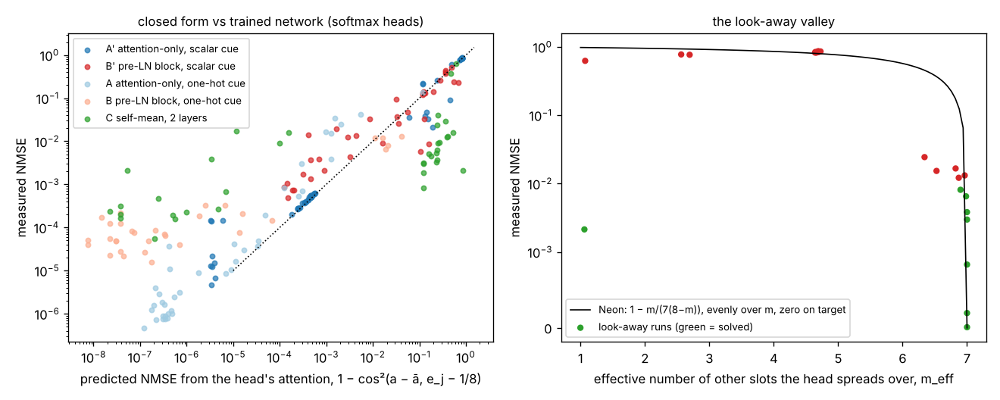

# ShadowValley

**Does HEAD's "look-away" trap happen in transformer attention, and what gets a head out of it?**

Short answer: the trap reproduces at HEAD's numbers in a transformer attention layer whose query sees only a scalar cue. A closed formula predicts how much error a trapped head is left with. Unsigned ("flashlight") routing feedback removes the trap in 20/20 seeds for both target signs, and the controls show that its information, not extra training pressure, does the work. Standard pre-LN blocks and richer queries mostly avoid the trap. In some seeds they instead learn the exact opposite reader: a head that reads a token by *not* attending to it. All results are from 600 small CPU runs (`results/cells.json`).



## The trap

[HEAD](https://github.com/anttiluode/HEAD) found it in a 323-parameter reader. Eight slots hold x_i = c + d_i. The detail d sums to zero, and a cue c picks a hidden slot j. The target is d_j = x_j − mean(x), and the mean is already available on another path. The detail sums to zero, so every wrong slot is slightly anti-correlated with the target. That makes "look away from j, average the others, flip the decoder sign" a valid solution too. If the decoder starts with the wrong sign, gradient descent goes that way and stalls partway.

For any attention row a over the 8 slots, signed or not, with an optimal linear readout given the cue:

    NMSE(a) = 1 − cos²(a − mean(a),  e_j − 1/8)

Neon's curve, 1 − m/(7(8−m)) with decoder weight −m/(8−m), is the special case of attention spread evenly over m wrong slots with zero weight on j (`tests/test_sv.py`). Only two families of attention rows are exact. One peaks on j. The other gives j any weight and spreads the rest *evenly* over the other 7. Softmax can produce one high logit cheaply. Making 7 logits exactly equal is much harder.

## Setup (`sv.py`, `run_all.py`)

The same task is written as tokens: 8 slot tokens and 1 query token, d_model = 32, Adam lr 3e-3, 2,000 steps × 256 examples. Each run is scored on 8,192 fresh examples. A run is **solved** at NMSE < 0.01. The read is classified per cue, by the last layer's query row (best head):

* **at:** the largest |weight| is on j and positive.
* **neg-at:** the largest |weight| is on j and negative.
* **away:** j is not the largest, and the row points away (cos < 0).

| architecture | what the query knows |
|---|---|
| **A′** attention-only layer (no LayerNorm, no MLP), linear readout | scalar cue level c only (HEAD's condition) |
| **B′** one standard pre-LN block (attention + GELU MLP) | scalar cue level c only |
| **A**, **B** the same two | c plus a one-hot cue embedding (rich query) |
| **C** two pre-LN blocks | nothing: it must compute the average itself and route from it |

| routing rule | what it is |
|---|---|
| softmax | standard |
| differential | Ye et al. 2024: softmax(Q₁K₁) − λ·softmax(Q₂K₂), learnable λ, λ_init 0.8. The per-head GroupNorm is omitted. |
| cog | Lv et al. 2024: sign(qk)·softmax(\|qk\|) |
| flashlight | Softmax unchanged at inference. For the first 25% of training, HEAD's auxiliary is added (weight 0.25): per cue, the slot whose centred reading has the largest **squared** correlation with the detached residual becomes a cross-entropy target for the routing logits. Cue bins come from the task design; no slot labels. |

## Results (20 seeds per cell, `results/summary.md`)

| cell | solved | at / neg-at / away / other | trapped look-away runs |
|---|---|---|---|
| **A′ softmax** | 9/20 | 14 / 0 / 6 / 0 | **6 runs: m_eff 4.69, β −1.31, NMSE 0.851** |
| A′ softmax, 4× longer | 9/20 | 14 / 0 / 6 / 0 | the **same 6 seeds**, NMSE 0.77–0.86 |
| A′ softmax, target sign reversed | 11/20 | 15 / 0 / 5 / 0 | 5 runs: m 4.72, **β +5.17**, NMSE 0.804 |
| A′ softmax, **i.i.d. detail** (no zero-sum) | **20/20** | 20 / 0 / 0 / 0 | – |
| A′ softmax, 2 heads | 10/20 | 16 / 0 / 3 / 1 | 3 runs: NMSE 0.653 |
| A′ differential | 13/20 | 10 / 7 / 1 / 2 | 1 run |
| A′ cog | 9/20 | 10 / 7 / 1 / 2 | 1 run |
| **A′ flashlight (unsigned teacher)** | **20/20** | 20 / 0 / 0 / 0 | – |
| A′ flashlight, target reversed | **20/20** | 20 / 0 / 0 / 0 | – |
| A′ signed teacher, target reversed | 1/20 | 12 / 0 / 8 / 0 | 8 runs, NMSE 0.785 |
| A′ teacher fed residuals from another batch (shuffled) | 8/20 | 12 / 0 / 7 / 1 | 7 runs, NMSE 0.823 |
| A′ teacher with a fixed random table | 0/20 | 9 / 0 / 11 / 0 | 11 runs, NMSE 0.932 |
| B′ softmax | 5/20 | 19 / 0 / 0 / 1 | – (other failures: median NMSE 0.089) |
| B′ differential / cog / flashlight | 6 / 9 / 9 of 20 | | – |
| B′ softmax, 2 heads | 14/20 | 20 / 0 / 0 / 0 | – |
| A one-hot: softmax / diff / cog / flashlight | 14 / 20 / 18 / 20 of 20 | softmax: 12 / 0 / **8** / 0 | 3 unsolved, m 6.53, β −7.61, NMSE 0.017 |
| B one-hot: softmax / diff / cog / flashlight | 17 / 20 / 20 / 20 of 20 | softmax: 16 / 0 / **4** / 0 | 2 unsolved, NMSE 0.013 |
| C self-mean: softmax / diff / cog / flashlight | 14 / 12 / 6 / 16 of 20 | softmax: 19 / 0 / 1 / 0 | – |

### What this shows

1. **The valley is real in transformer attention, at HEAD's numbers.** In A′, 6/20 seeds learn to look away. They spread over 4.7 of the wrong slots with decoder β = −1.31 and are left at NMSE 0.85. HEAD's eight failures had β −1.40 and NMSE 0.80–0.84. Training 4× longer leaves the same six seeds stuck, so it is a trap, not slow convergence.
2. **The closed form predicts the trained network.** Across all A′ softmax and flashlight runs, measured NMSE and 1 − cos²(a − ā, e_j − 1/8) computed from the head's own attention correlate at 0.98, with a median gap of 6×10⁻⁵ (`results/summary.json`). Neon's even-spread curve gives 0.80 at m = 4.7 against 0.85 measured. Real heads do not spread evenly, and the general form covers that.
3. **The mechanism is the zero-sum anti-correlation, as stated.** With i.i.d. detail the look-away solution carries no information, and the trap disappears: 20/20 solved, 0 look-away. Reversing the target sign reverses the trapped decoder sign (β +5.17) at about the same rate (5/20).
4. **Unsigned routing feedback removes it, and its information is what matters.** The flashlight teacher solves 20/20 at both target signs. The signed teacher solves 1/20 on the reversed target, with 8 trapped: HEAD's sign result, now in a transformer. Two information-free controls keep the same auxiliary loss. A teacher fed residuals from another batch gets 8/20, the same as plain softmax. A fixed random table gets 0/20. So extra training pressure on the router does not explain the rescue.
5. **Differential and Cog attention do not remove failures here.** They nearly eliminate the look-away trap: 1/20 each in A′, where softmax had 6/20. Often (7/20) they instead point *at* the answer with a negative weight, a reading softmax cannot express. Their solve rate stays at 13/20 and 9/20, because other failures remain. An expressivity fix and a credit fix are different things, and on this task the credit fix is the one that works.
6. **The bridge to standard blocks is weaker than hoped.** One pre-LN block with an MLP (B′) shows **no** look-away traps (0/20). It fails in a different way: correct routes with an incomplete fit, median NMSE 0.09. The flashlight helps less there (9/20 vs 5/20); a second head helps more (14/20). In the 2-layer network that must compute the average itself (C), look-away shows up in 1/20 runs.
7. **Richer queries escape, sometimes to the opposite reader.** With a one-hot cue, 8/20 (A) and 4/20 (B) softmax seeds look away and still mostly solve. They reach the exact complement: m_eff → 6.5–6.9 and β ≈ −6 to −7.6. That head's attention map says it ignores the answer token, and the answer token is exactly what it reads. Its read carries |β|² ≈ 36–58× the noise sensitivity of a direct read (HEAD measured 49× for the ideal complement).

### Honest scope

This is one synthetic 8-slot task with scalar values, tiny models and CPU runs. Whether some heads in real language models compute "item minus context average" by complement reading is untested; finding 7 is the reason to look. The flashlight teacher needs cue bins supplied by the task design, which a real model doesn't hand you. Differential attention is implemented without its per-head GroupNorm, and Cog attention in its basic form. The known part: softmax cannot assign negative weight (the motivation for Differential and Cog attention), and attention maps are not faithful explanations (Jain & Wallace 2019; Wiegreffe & Pinter 2019). What this repo adds: a specific gradient-descent trap, a closed form that predicts the trained network's error, the condition that creates it (zero-sum target and an average on another path), and a credit-side fix that survives sign reversal.

**A methods note.** The first version of the shuffled control permuted residuals *within each batch and cue*. A random permutation has on average one fixed point, so about 1/n of the true correlation leaked through (n ≈ 32 per cue). That was enough for the teacher to find the slot, and the control "solved" 19/20. The control now pairs each batch's readings with residuals from the previous batch. HEAD's `unsigned.py` uses the within-batch permutation too. It reported 0/10 there, so the leak did not matter in that setting, but it is worth knowing.

## Reproduce

Windows, Python 3.13 (CPU is enough):

```
py -3.13 -m pip install -r requirements.txt
py -3.13 -m pytest -q tests                # 5 tests, seconds
py -3.13 run_all.py --quick                # 3 seeds per cell, a few minutes
py -3.13 run_all.py                        # full: 600 runs, ~3 CPU-hours, spread over all cores
py -3.13 summarize.py                      # results/summary.md, summary.json, figure.png
```

On Linux or macOS use `python3`. To rerun one cell: `py -3.13 run_all.py --only "A' attn, scalar cue | softmax"`.

## Files

* `sv.py`: the task, the three architectures, the four routing rules, the teacher and its controls, and the measurements.
* `run_all.py`: the cells and the parallel runner.
* `summarize.py`: tables, formula checks and the figure.
* `results/cells.json`: every run, including per-cue attention measurements and training traces.

Built by Claude (Opus 5.5) from HEAD (Sol), Neon's Shadow Valley formula and the sign-blind routing idea.
